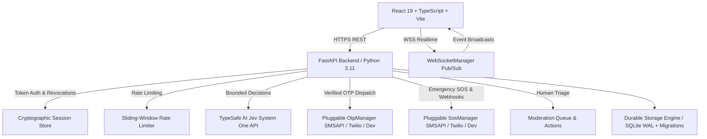

# CartMate Polska — Engineering Handoff & Production Architecture

> **Historical architecture record, 2026-10-01:** Product and test snapshots below include superseded paid-service and age-gate assumptions. The active no-cost website decision, current Gemini scope and latest release status are in `GEMINI_HANDOFF.md`, `context/progress-tracker.md` and `LAUNCH_READINESS.md`. Do not use this file alone as launch approval.

> **Latest local update, 2026-09-30 (group/safety slice):** 127/127 backend, 40/40 local desktop/mobile browser, 4/4 isolated no-demo browser, 3/3 local recovery drills, and frontend build/lint passed. Votes no longer auto-admit people to group chat; joining/leaving is explicit and transactional, and a group message can be reported with sender-bound evidence. Spot/group dialogs have new keyboard/narrow-screen checks; deployed WebSockets now validate Origin, frame size and idle session/adult status. This is not hosted or independent-review evidence. Read `LAUNCH_READINESS.md` and `qa/PRE_PILOT_REVIEW.md`; older figures below are historical. Live service remains closed for lack of an approved real age-assurance method.

> **Current integration update, 2026-09-30:** The repository now passes **122/122 backend tests with no skips**, frontend build/lint, 36/36 local development browser cases, and 4/4 isolated no-demo cases. The previously skipped deployed-region tests run, and a cold-hydrated legacy Warsaw hotspot/outing regression passes. Existing WebSockets are closed on block, blocked chat/trip/outing scopes cannot be re-subscribed, server `user_voted` drives the voting UI, and the “other devices” action preserves the current session. Browser regressions cover populated blocked-user Profile, current-session preservation and empty-avatar voting. The approved 18+ rule now fails closed on deployed live REST and WebSocket routes; a truthful pending screen replaces live access. **The founder chose “not chosen yet — keep it closed” for the age-assurance method.** No real provider is trusted or connected; only the isolated `qa/staging_harness.py` has a local test adapter. `/api/ready` stays blocked without a real age provider. No hosted CI, Render deployment, SMSAPI carrier exercise, encrypted offsite recovery, qualified privacy review, or live pilot is evidenced. Earlier test counts and admission descriptions below are historical; use `LAUNCH_READINESS.md` for current gates.

> **Completion review, 2026-09-29:** Read [NEXT_MODEL_EXECUTION_PLAN.md](NEXT_MODEL_EXECUTION_PLAN.md) before implementation. Existing suites were reproduced, but additional probes found open privacy, blocking, region and UI/API contract defects. E00–E09 defines the remaining repository work; U01–U07 identifies founder/provider dependencies. This planning pass changed documentation only; historical implementation claims below do not close those findings.

> **Repository:** `S:\APPs\cartmate`  
> **Status:** Not ready for public launch — see [`LAUNCH_READINESS.md`](LAUNCH_READINESS.md) for the current release board. This handoff contains historical implementation notes and older test output.  
> **Current product decision (updated 2026-09-30):** Web-first information may address Poland nationwide, but live outings remain invite-only in the Katowice/GZM pilot area. Live membership is **18+ by approved policy**; a fail-closed server gate now exists, but no approved age-assurance method or real proof integration exists, so no real invitations are approved. SMS proves phone control only. See [`PRODUCT_NARRATIVE_AND_ROLLOUT.md`](PRODUCT_NARRATIVE_AND_ROLLOUT.md).  
> **Latest local verification (2026-09-29, final):** **116 passed + 2 skipped** backend tests (108 original + 8 E01 completion regressions in `backend/test_completion_regressions.py` covering the F02–F07 privacy/blocking/region/contract defects; the 2 skips are production-semantics region tests that run in staging-mode subprocess coverage), frontend typecheck/build/lint, 32/32 development browser cases, and 4/4 no-demo staging-like browser cases pass locally on the fixed tree. Migration v6 makes six-digit OTP challenges and per-phone/invite abuse budgets durable; shared trip events and blocked participant responses no longer disclose contact phones, and manual BLIK copy refreshes authorization first. Jev shadow-audit entries carry no free-text summaries or provider blobs and the audit endpoint is moderator-only; trip broadcasts carry no follow-up entries; blocked pairs are excluded from auto-formed groups; report categories match the backend enum; out-of-region listings/joins/chat writes are denied in production mode; suspended users are hidden from discovery. Review and meet-again choices are optional and neutral by default; six trip dialogs have keyboard focus containment and labeled controls. The 2/2 sample-schema backup/restore mechanics drill passes locally; it does not prove hosted/offsite recovery or restoration of every real table. Vite still warns about large app/map chunks. No hosted CI, real SMSAPI carrier exercise, Render deployment, or user pilot has been observed. Capacitor remains starter-only; Overpass, automated BLIK, and Jev arbitration are not implemented. The approved pilot scope is Silesia; SMS confirms phone control, not identity. See `LAUNCH_READINESS.md` for open launch gates.  
> **QA takeover:** Gemini went offline during the no-demo Silesia publisher journey. Codex completed and verified it locally; [`GEMINI_HANDOFF.md`](GEMINI_HANDOFF.md) records the takeover and remaining QA slices. The release board remains [`LAUNCH_READINESS.md`](LAUNCH_READINESS.md).  

---

## 1. Product Identity & Philosophy

CartMate is an offline-connection product for grocery, shopping, and everyday errands. The implemented live pilot boundary is centered on Katowice/GZM (approximately 35 km from Katowice), **not** the whole Silesian Voivodeship; Warsaw, Kraków, and Wrocław are catalogued expansion configurations, not approved live markets. It aims to make ordinary errands easier to do together, but has not launched or demonstrated an effect on loneliness.

### Core Tenets
1. **People Over Radar:** Discovery highlights human faces, names, and real intentions rather than sterile radar dots or surveillance maps.
2. **Anti-Gig-Economy:** CartMate is **not** a courier service, TaskRabbit, or transactional gig platform. Neighbors shop and hang out together as equals.
3. **Shared Intent:** Connection is driven by purpose (`#PromocjaWielosztuki`, `#NocneGastro`, `#DźwiganieZgrzewek`, `#KawaIPogaduchy`, `#Paczkomat`).
4. **Solving the Real Reasons People Don't Meet:**
   - **Specific Plans:** Clear definition of *what*, *when*, *how long*, and *what it costs* (cost sharing policy) before meeting.
   - **Mutual Acceptance:** Both host and companion must confirm plan terms before check-in or PIN handshake can proceed.
   - **Low-Guilt Cancellation:** Non-punitive cancellations with reason tags preserve Manner temperature and eliminate psychological guilt.
   - **Mutual Shopping Buddies:** A mutual "meet again" follow-up forms a permanent trusted connection only when both participants independently confirm `would_meet_again: True`.
5. **Mutual Safety & Privacy by Design:** Strict separation of public profiles, participant-only coordination data, minimal coordinate coarsening (~1.1 km), and private account PII.
6. **Production Truth & Deterministic Fallbacks:** CartMate never pretends emergency alerts or SMS are delivered without confirmed carrier receipts, removes invalid 112 SMS paths, fails closed outside development, and provides deterministic native emergency fallbacks (`tel:112`).
7. **Durable Persistence & Cold Restart Recovery:** SQLite WAL and versioned migrations persist tested application state. The restart test checks selected records; it is not a zero-data-loss guarantee or a substitute for backup/restore drills.

---

## 2. System Architecture



### Component Breakdown
- **Frontend (`/frontend`):** React 19, TypeScript, Vite 8, Tailwind CSS, Lucide icons.
  - `src/realtime/socket.ts`: Auto-reconnecting WebSocket client with exponential backoff, jitter, and heartbeat.
  - `src/api.ts`: Typed REST client utilizing cryptographic `Authorization: Bearer <token>` headers, provider OTP request/verify methods, verified registration, truthful SOS triggers, plan acceptance, trip cancellation, shopping buddies, user blocking/unblocking, human abuse reporting, and session revocation.
  - `src/App.tsx`: Zero redundant polling while WebSocket is active (polling timer strictly cleared upon `connected` event; degraded 30s timer only during disconnection). Defaults to Katowice (Silesia launch market).
  - `src/components/ActiveTripHUD.tsx`: Mutual plan acceptance, self-reported check-in, meeting-PIN entry (not location verification), 50/50 estimate ledger only after an accepted 50/50 policy, SOS disclosure, report/block actions, and optional follow-up review.
  - `src/components/ProfileView.tsx`: Profile, shopping buddies, session revocation, blocked-user management, and participant-review score disclosure. Social/identity checks are not available in deployed environments.
  - `src/components/AuthModal.tsx`: Provider-backed SMS OTP flow for phone numbers. Email OTP is not supported by the current provider integration.
  - `src/components/CreatePingModal.tsx`: Shopping ping publisher integrated with Jev AI for tag suggestions, rendezvous point recommendations, and automated content screening.
  - `src/components/SpotVotingWidget.tsx`: Memoized crowdsourced neighborhood spot voting with Katowice store presets, automatic threshold conversion into group outings, and real-time chat.
  - `src/components/LiveRadarView.tsx`: Memoized human-centric radar view with Katowice and Silesian metro presets.
- **Backend (`/backend`):** FastAPI, Pydantic v2, WebSockets, Python 3.11.
  - `main.py`: REST routes, WebSocket endpoint `/ws`, dependency-injected auth checks (`Depends(require_user)`), session revocation checks, banned account lockouts, plan mutual acceptance endpoints, trip cancellation, buddy follow-up, user blocking, abuse reporting, and moderation queue triage.
  - `storage.py`: SQLite ACID storage engine with WAL mode and versioned schema migrations (`schema_migrations`), persisting users, sessions, revoked tokens, trips, plan details, SOS records, hotspot votes, chat messages, user blocks, moderation reports, and shopping buddies.
  - `config.py`: Regional boundary configurations (Silesia launch market), validated `OperationalThresholds` model (limits on plan durations, OTP/chat/reports/SOS rate limits, PIN attempts, coordinate coarsening), and `assert_deployment_environment()`.
  - `rate_limiter.py`: Sliding-window in-memory rate limiter with per-key buckets, rolling cutoff, and HTTP 429 exceptions with `Retry-After` headers.
  - `sanitizer.py`: PII masking for phone numbers, emails, tokens, and coordinates; includes `SensitiveDataLogFilter` scrubbing sensitive credentials from Python root logger.
  - `auth_providers.py`: Pluggable `OtpProvider` interface with `DevConsoleOtpProvider`, `SmsApiPlOtpProvider`, and `TwilioOtpProvider`. Fails closed outside dev mode. Rate-limiting (max 3 req/10min), 60s cooldown, 5-min TTL, single-use replay protection.
  - `sos_providers.py`: Pluggable `SosDispatchProvider` interface with truthful carrier delivery tracking, carrier webhook receipt processing, and direct 112 voice fallback (no bogus SMS-to-112).
  - `websocket_manager.py`: Thread-safe pub/sub engine with strict scope authorization (`city:<name>`, `user:<self_id>`, `outing:<id>`, `trip:<id>`) and room membership enforcement.
  - `jev_service.py`: Real HTTP integration with TypeSafe AI Jev official System One API (`POST https://api.typesafe.ai/v1/systemone` using model `jev-latest`), request questions with `criteria`, response parsing under `answers` with `noul`, strict fail-closed safety, and pre-send PII sanitization.
  - `database.py`: Hydrated live data store synchronized with `storage.py`.

---

## 3. Safety, Abuse Protections & Real Reasons People Don't Meet

### A. Specific Plan Invariant & Mutual Acceptance
- **Psychological Friction Eliminated:** People hesitate to meet strangers when expectations are vague. CartMate requires every accepted trip to contain explicit `PlanDetailsSchema`:
  - `what_activity`: specific purpose (e.g. "Szybkie zakupy i obiad w Galerii Katowickiej")
  - `when_time`: explicit meeting timeframe (e.g. "Dzisiaj, 18:30")
  - `estimated_duration_minutes`: bounded duration (15–240 minutes)
  - `cost_policy`: transparent cost expectation (`split_strictly_50_50`, `buyer_pays_own`, `host_treats`, `companion_treats`, `no_purchase_browse_only`)
  - `estimated_budget_pln`: optional agreed budget ceiling
- **Server-Enforced Mutual Acceptance:** When a host accepts a join request, `host_accepted` is set to `True` and `companion_accepted` is `False`.
  - The companion must explicitly call `POST /api/trips/{trip_id}/accept-plan`.
  - **Hard Invariant:** Attempting in-store check-in (`POST /api/trips/{id}/checkin`) or PIN verification (`POST /api/trips/{id}/verify-pin`) before both parties confirm plan terms fails closed with HTTP 400 Bad Request.

### B. Low-Guilt, Non-Punitive Cancellation
- **No Social Hostage-Taking:** If circumstances change, participants can exit an outing without guilt or penalty via `POST /api/trips/{trip_id}/cancel`.
- **Reason Tags:** `changed_mind`, `scheduling_conflict`, `bad_weather`, `emergency`, `no_longer_needed`, `other`.
- **Manner Temperature Preservation:** Early, honest cancellations preserve the user's Manner temperature (unlike no-shows or harassment). Status transitions to `CANCELLED`, unblocking both users.

### C. Mutual Shopping Buddy ("Meet Again") Flow
- Post-trip wrap-up follow-up via `POST /api/trips/{trip_id}/follow-up`.
- **Double-Opt-In Invariant:** A persistent `ShoppingBuddy` relationship is created if and only if **both** participants independently confirm `would_meet_again: True`. If one participant declines, no buddy connection is formed, and no awkward rejection notification is sent.

### D. Server-Enforced Access Checks & Bidirectional Blocking
- **Access Control:** Unauthorized third parties cannot view trip details, retrieve host PINs, inject chat messages, or trigger actions on trips they do not belong to (HTTP 403 Forbidden).
- **Bidirectional Invisibility:** When User A blocks User B via `POST /api/users/{id}/block`:
  - User B cannot see User A's active pings on the radar (`GET /api/pings`).
  - User B cannot send waves (`POST /api/pings/{id}/wave`) to User A (HTTP 403).
  - User B cannot submit join requests (`POST /api/pings/{id}/join`) to User A (HTTP 403).
  - User B cannot inject messages into User A's chat rooms (HTTP 403).
  - Public directory `GET /api/users/all` completely filters out blocked relationships bidirectionally.

### E. Human Moderation Queue & Immediate Session Revocation
- **Abuse Reporting:** Users can report misconduct via `POST /api/reports` with categories: `harassment`, `inappropriate_content`, `no_show`, `safety_risk`, `commercial_spam`, `misrepresentation`, `other`.
- **Human Triage:** Reports enter a prioritized human moderation queue (`GET /api/moderation/queue`).
- **Enforcement Actions:** Moderators take actions via `POST /api/moderation/reports/{id}/action`:
  - `warn`: records warning note.
  - `suspend`: temporarily suspends account with reason.
  - `ban`: permanently bans account and **immediately revokes all active session tokens across all devices**.
  - Subsequent requests with tokens belonging to suspended or banned users are rejected with HTTP 403 Forbidden.

### F. Session Revocation & Multi-Device Security
- Active sessions tracked in `user_sessions` and revocations recorded in `revoked_sessions`.
- `POST /api/auth/logout`: revokes current token.
- `POST /api/auth/revoke-all-sessions`: revokes all active tokens for current user across devices.
- `GET /api/auth/sessions`: lists active sessions with masked token previews.
- Revoked tokens are rejected with HTTP 401 Unauthorized across all protected routes and WebSockets.

### G. Sliding-Window Rate Limiting
- Enforced via `SlidingWindowRateLimiter` on critical endpoints:
  - OTP requests: 3 requests per 10 minutes.
  - Chat messages: 30 messages per minute.
  - Moderation reports: 5 reports per 15 minutes.
  - PIN verification: 5 attempts per trip.
  - Exceeding limits returns HTTP 429 Too Many Requests with standard `Retry-After` header.

### H. Minimal Location Sharing & PII Shielding
- Public user DTOs (`UserPublicSchema`) strictly redact private emails, phone numbers, emergency contacts, and street addresses.
- Coordinates for discovery pings are coarsened to 2 decimal places (~1.1 km precision) to prevent physical stalkability.
- Verbal rendezvous PINs are only visible to the host; companions must receive the PIN in person.
- Log sanitizer (`SensitiveDataLogFilter`) scrubs bearer tokens, phone numbers, emails, and webhook secrets from server logs.
- Pre-send Jev AI scrubber redacts emails, national IDs (PESEL), postal codes, street addresses, phone numbers, payment card numbers (`[KARTA]`), and secrets/PINs (`[SEKRET]`).

---

## 4. Selected Cold-Restart Recovery Test

### Test Scope
> The test purges selected in-memory structures and rehydrates from SQLite. It checks selected records and denials; it does not prove zero data loss, hard-crash behavior, backup integrity, or restore capability.

### Empirical Proof & Conclusion
Validated empirically in `test_durability_restart_and_recovery_demonstration` (`test_real_reasons_and_abuse_protections.py`):
1. **Initial State Created:** Active users, bidirectional blocks, mutual shopping buddies, planned trips with mutual acceptance, moderation reports, and session revocations were generated and persisted to SQLite.
2. **Cold Crash Simulated:** Process memory was completely cleared (`ACTIVE_SESSIONS.clear()`, `BLOCKED_USERS.clear()`, `SHOPPING_BUDDIES.clear()`, `REPORTS.clear()`, `REVOKED_TOKENS.clear()`, `TRIPS.clear()`).
3. **Cold Recovery Executed:** Database re-initialization and hydration was invoked (`initialize_database()`).
4. **Empirical Results:**
   - User blocks survived: Blocked users remained bidirectionally invisible and blocked from pings/waves.
   - Revoked tokens survived: Revoked sessions remained rejected with HTTP 401.
   - Banned accounts survived: Banned users remained locked out with HTTP 403.
   - Mutual buddies survived: Buddy connections and trip counts hydrated accurately.
   - Agreed plans survived: Duration, cost sharing policies, and acceptance timestamps persisted intact.
   - Moderation reports survived: Report status and categories recovered without data loss.
5. **Conclusion:** The tested records recovered in this test. A production backup/restore drill and incident recovery procedure remain release gates.

---

## 5. Verification & Test Evidence

### Historical Backend Test Log (58-case snapshot; current evidence is in `LAUNCH_READINESS.md`)
```
test_product_decisions.py::test_silesian_launch_market_config PASSED
test_product_decisions.py::test_health_check_silesia_and_providers PASSED
test_product_decisions.py::test_otp_request_and_verification_flow PASSED
test_product_decisions.py::test_truthful_sos_trigger_and_status PASSED
test_product_decisions.py::test_sos_unconfirmed_and_empty_payload_refused PASSED
test_product_decisions.py::test_forged_dlr_rejected_and_authenticated_receipt_updates_status PASSED
test_product_decisions.py::test_production_mode_rejects_demo_tokens PASSED
test_product_decisions.py::test_registration_requires_verified_otp PASSED
test_product_decisions.py::test_typesafe_jev_systemone_contract_and_presend_sanitization PASSED
test_product_decisions.py::test_jev_shadow_mode_intent_classification PASSED
test_product_decisions.py::test_jev_content_safety_screening PASSED
test_product_decisions.py::test_typesafe_systemone_contract_request_shapes_and_fail_closed_parsing PASSED
test_product_decisions.py::test_sos_webhook_secret_header_only_and_query_string_rejected PASSED
test_product_decisions.py::test_cartmate_env_and_deployment_assertions PASSED
test_product_decisions.py::test_durable_storage_and_restart_hydration PASSED
test_real_reasons_and_abuse_protections.py::test_specific_plan_details_and_mutual_acceptance_flow PASSED
test_real_reasons_and_abuse_protections.py::test_easy_low_guilt_trip_cancellation PASSED
test_real_reasons_and_abuse_protections.py::test_simple_follow_up_to_meet_again_creates_mutual_buddy PASSED
test_real_reasons_and_abuse_protections.py::test_server_enforced_access_checks_for_unauthorized_actors PASSED
test_real_reasons_and_abuse_protections.py::test_minimal_location_sharing_and_pii_shielding PASSED
test_real_reasons_and_abuse_protections.py::test_session_revocation_and_lockout PASSED
test_real_reasons_and_abuse_protections.py::test_rate_limiting_enforcement PASSED
test_real_reasons_and_abuse_protections.py::test_user_blocking_and_human_moderation_triage PASSED
test_real_reasons_and_abuse_protections.py::test_jev_presend_pii_redaction_and_abuse_cases PASSED
test_real_reasons_and_abuse_protections.py::test_durability_restart_and_recovery_demonstration PASSED
test_realtime_and_jev.py::test_websocket_unauthorized_missing_token PASSED
test_realtime_and_jev.py::test_websocket_unauthorized_invalid_token PASSED
test_realtime_and_jev.py::test_websocket_authenticated_connection PASSED
test_realtime_and_jev.py::test_websocket_heartbeat_ping_pong PASSED
test_realtime_and_jev.py::test_websocket_scope_subscription PASSED
test_realtime_and_jev.py::test_websocket_unauthorized_chat_rejected PASSED
test_realtime_and_jev.py::test_wave_at_ping_authenticated PASSED
test_realtime_and_jev.py::test_wave_at_nonexistent_ping PASSED
test_realtime_and_jev.py::test_hotspot_voting_and_outing_creation PASSED
test_realtime_and_jev.py::test_jev_intent_classification_promocja PASSED
test_realtime_and_jev.py::test_jev_intent_classification_nocne_gastro PASSED
test_realtime_and_jev.py::test_jev_intent_classification_zgrzewka PASSED
test_realtime_and_jev.py::test_jev_content_safety_clean PASSED
test_realtime_and_jev.py::test_jev_content_safety_unsafe_rejection PASSED
test_realtime_and_jev.py::test_jev_suggest_rendezvous PASSED
test_security_baseline.py::test_health_check PASSED
test_security_baseline.py::test_unauthenticated_protected_route PASSED
test_security_baseline.py::test_invalid_bearer_token PASSED
test_security_baseline.py::test_authenticated_user_me PASSED
test_security_baseline.py::test_public_users_pii_shielding PASSED
test_security_baseline.py::test_pings_privacy PASSED
test_security_baseline.py::test_trip_rendezvous_pin_not_in_general_response PASSED
test_security_baseline.py::test_host_can_view_pin PASSED
test_security_baseline.py::test_companion_cannot_view_pin_endpoint PASSED
test_security_baseline.py::test_unauthorized_user_cannot_access_trip PASSED
test_security_baseline.py::test_pin_verification_rate_limiting PASSED
test_security_baseline.py::test_safehaven_eligibility_enforced PASSED
test_security_baseline.py::test_login_validation PASSED
test_security_baseline.py::test_list_hotspots PASSED
test_security_baseline.py::test_hotspot_voting_and_threshold_formation PASSED
test_security_baseline.py::test_hotspot_voting_idempotent PASSED
test_security_baseline.py::test_chat_room_and_message_delivery PASSED
test_security_baseline.py::test_unauthorized_user_cannot_access_or_send_chat PASSED

============================= 58 passed in 2.82s ==============================
```

### Historical Frontend Build Snapshot
```
> frontend@0.0.0 build
> tsc -b && vite build

vite v8.3.1 building client environment for production...
transforming...
✓ 1900 modules transformed.
rendering chunks...
computing gzip size...
dist/index.html                   0.60 kB │ gzip:   0.38 kB
dist/assets/index-Cy5iHovJ.css   85.38 kB │ gzip:  12.21 kB
dist/assets/index-BpfIu33C.js   495.59 kB │ gzip: 135.43 kB
✓ built in 2.30s
```

---

## 6. Startup & Environment Commands

### Backend Server
```powershell
cd S:\APPs\cartmate\backend
python -m uvicorn main:app --host 0.0.0.0 --port 8000 --reload
```
- Health Check: `http://localhost:8000/api/health`  
- Environment Check: `http://localhost:8000/api/config/environment`  
- Regions API: `http://localhost:8000/api/config/regions`  
- Moderation Queue: `http://localhost:8000/api/moderation/queue`  
- Active Sessions: `http://localhost:8000/api/auth/sessions`  
- Shopping Buddies: `http://localhost:8000/api/users/me/buddies`  
- Jev Shadow Audit: `http://localhost:8000/api/ai/shadow-audit`

### Frontend Development Server
```powershell
cd S:\APPs\cartmate\frontend
npm run dev
```
Client URL: `http://localhost:5173`

### Environment Configuration Reference
- `CARTMATE_ENV`: Set explicitly to `staging` or `production` in live environments. Prohibited from implicit fallback.
- `CARTMATE_DATABASE_PATH`: SQLite database file path (defaults to `cartmate/backend/cartmate.db`).
- `CARTMATE_DEFAULT_REGION`: Default regional market (`silesia`).
- `OTP_PROVIDER`: OTP SMS/email gateway provider (`smsapi`, `twilio`, `console`).
- `SOS_PROVIDER`: Emergency SOS alert dispatch gateway (`smsapi`, `twilio`, `console`).
- `SOS_WEBHOOK_SECRET`: Shared secret header (`X-Webhook-Secret`) for carrier DLR webhook verification.
- `TWILIO_STATUS_CALLBACK_URL`: Webhook URL configured on Twilio messages for carrier delivery status receipts.
- `JEV_MODE`: Jev evaluation operational mode (`shadow`, `enforce`, `disabled`).
- `TYPESAFE_JEV_API_KEY`: API key for TypeSafe AI Jev models (`POST https://api.typesafe.ai/v1/systemone`).
- `SMSAPI_API_TOKEN`: API token for Polish SMSAPI.pl gateway.
- `TWILIO_ACCOUNT_SID` & `TWILIO_AUTH_TOKEN`: Twilio credentials.
- `VITE_WS_URL`: (Optional) Custom WebSocket endpoint URI (defaults to `ws://localhost:8000/ws`).
