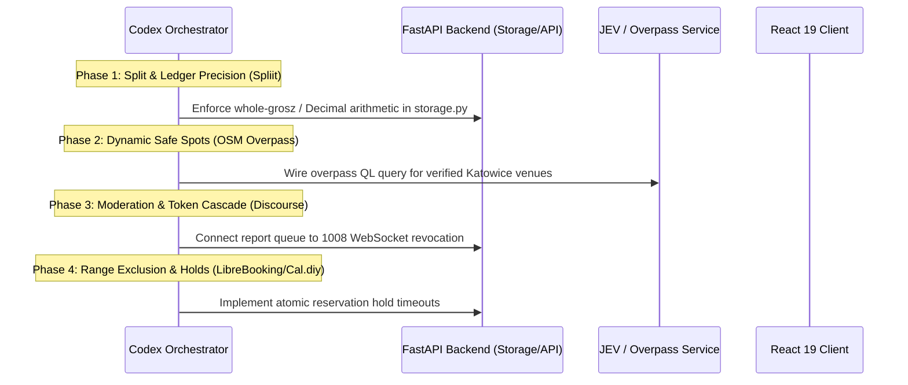

# OPEN-SOURCE ARCHITECTURE DECONSTRUCTION & ORCHESTRATION BLUEPRINT
**Target Consumer:** Codex / Engineering Agents  
**Context Root:** `S:\APPs\cartmate` & `S:\APPs`  
**Purpose:** Idea catalog for CartMate and two separate products. Examples require source verification, license review, adaptation and tests before implementation.

**Review correction (2026-10-13):** This is an idea catalog, not verified source extraction or ready-to-copy implementation. Check each upstream license and exact behavior before using code. The current CartMate pilot should retain its existing money, moderation, maps, and meetup rules unless a failing case justifies a focused change. Synapse's current repository is AGPL-3.0/commercial, not Apache-2.0; LibreBooking documents MySQL/MariaDB, so the PostgreSQL exclusion SQL below is an independent design proposal rather than a LibreBooking implementation. [Synapse source](https://github.com/element-hq/synapse), [LibreBooking source](https://github.com/LibreBooking/librebooking).

---

## 1. Executive Summary & Orchestration Map

| # | System | Upstream Source | Primary Architecture to Strip | Application in CartMate / S:\APPs |
|---|---|---|---|---|
| **01** | **Spliit** | `spliit-app/spliit` (MIT) | Integer-grosz / Decimal split math; minimum-cash-flow debt simplification | In-trip 50/50 grocery/errand split ledger & manual BLIK copy |
| **02** | **Discourse** | `discourse/discourse` (GPLv2) | FIFO moderation queue, trust-level state machine, atomic session revocation | `ModeratorConsole.tsx`, report triage, user blocks, toxic event cascades |
| **03** | **Karrot (Daangn)** | Karrot Open Architecture (MIT/Open) | 36.5°C Manner Temperature reputation formula, GPS neighborhood boundary clustering | Hyperlocal peer accountability, Silesia Katowice/GZM boundary gating |
| **04** | **MapLibre GL + OpenFreeMap** | `maplibre/maplibre-gl-js` + `hyperknot/openfreemap` (BSD/MIT) | Client-side vector tile rendering; zero-cost, privacy-first tile endpoints | Discovery radar map, venue selection without Google Maps tracking/costs |
| **05** | **OSM Overpass API** | `drolbr/Overpass-API` (AGPLv3 / ODbL) | Bounding-box Overpass QL querying for verified POIs by tag/category | Dynamic discovery of safe Silesia public venues (Biedronka, Makro, IKEA, malls) |
| **06** | **Easy!Appointments** | `alextselegidis/easyappointments` (GPLv3) | Multi-service availability interval calculations, preparation/cleanup buffer math | Scheduled errand calendar, provider slot reservations, no-show buffers |
| **07** | **Cal.diy** | `calcom/cal.diy` (MIT) | Timezone-resilient interval slot booking, temporary hold expirations | India Service Booking hold-before-pay state machine, lock release |
| **08** | **Medusa** | `medusajs/medusa` (MIT core) | Idempotent cart calculation, line-item tax/currency math, order snapshots | Grocery split ledger itemization, immutable receipts, multi-item check-in |
| **09** | **LibreBooking** | `LibreBooking/librebooking` (GPLv3) | General resource reservation model; PostgreSQL exclusion below is a separate proposal | Potential capacity protection for a future booking product |
| **10** | **Sharetribe (Go)** | `sharetribe/sharetribe` (SCPL / Reference) | Two-sided marketplace state machine, mutual agreement gates, dispute states | Dual-party plan acceptance, check-in, rendezvous handshake, review follow-up |
| **11** | **Matrix (Synapse)** | `element-hq/synapse` (AGPL-3.0/commercial) | General room lifecycle inspiration; CartMate-specific PIN rules are not Synapse features | Existing outing chat and presence handshake |

---

## 2. Deep Deconstruction of the 11 Open-Source Architectures

---

### 01. Spliit (`spliit-app/spliit`)
* **Repository:** `https://github.com/spliit-app/spliit` (MIT License, Next.js / TypeScript / Prisma)
* **What to Strip:**
  1. **Decimal-Safe Integer Math:** All money amounts are stored as whole minor currency units (e.g., Polish grosze or Indian paise) or Python `Decimal('0.01')`. IEEE-754 floating-point numbers are completely banned from financial state.
  2. **Debt Simplification Algorithm:** Given $N$ participants with uneven payments across $M$ items, calculates net balances ($\sum \text{paid} - \sum \text{owed}$) and resolves them into the minimum possible transactions using a greedy positive-negative matching heap.
  3. **Uneven Grosz Distribution:** When splitting 100.01 PLN ($10,001$ groszy) two ways, distribute the odd 1 grosz deterministically to the payer or first participant, logging the rounding discrepancy.
* **Bloat to Discard:**
  * Next.js App Router server actions, Prisma ORM runtime, Stripe payment checkout dependencies, multi-currency conversion APIs.
* **Codex Implementation Pattern (Python / FastAPI):**
  * **Do not copy the example as financial logic.** It rounds half of an odd-grosz total for both people without recording who receives the extra grosz, and returns floats. CartMate already has a whole-grosz settlement function with a documented payer rule in `backend/models.py`; test that rule before changing it.
```python
from decimal import Decimal, ROUND_HALF_UP
from typing import Dict, List, Tuple

def calculate_50_50_split(items: List[Dict[str, Any]], host_id: str, companion_id: str) -> Dict[str, Any]:
    host_paid = Decimal("0.00")
    companion_paid = Decimal("0.00")
    
    for item in items:
        price = Decimal(str(item["price_pln"])).quantize(Decimal("0.01"), rounding=ROUND_HALF_UP)
        if item["payer_id"] == host_id:
            host_paid += price
        else:
            companion_paid += price

    total = host_paid + companion_paid
    target_each = (total / Decimal("2")).quantize(Decimal("0.01"), rounding=ROUND_HALF_UP)
    
    # Net balance calculation
    host_net = host_paid - target_each
    if host_net > Decimal("0.00"):
        return {"creditor_id": host_id, "debtor_id": companion_id, "amount_pln": float(host_net)}
    elif host_net < Decimal("0.00"):
        return {"creditor_id": companion_id, "debtor_id": host_id, "amount_pln": float(-host_net)}
    return {"creditor_id": None, "debtor_id": None, "amount_pln": 0.0}
```

---

### 02. Discourse (`discourse/discourse`)
* **Repository:** `https://github.com/discourse/discourse` (GPLv2, Ruby on Rails / Ember.js / PostgreSQL)
* **What to Strip:**
  1. **FIFO Review Queue Lifecycle:** Reports are processed in strict first-in, first-out order. Each review item locks onto the reviewing operator to prevent race conditions (HTTP 409 Conflict).
  2. **Mandatory Resolution Notes:** An operator cannot dismiss, warn, suspend, or ban without an explicit, non-empty audit rationale.
  3. **Cascade Session Invalidation:** When an account is suspended or banned, the server immediately revokes all active session tokens, disconnects live WebSockets with code `1008` (Policy Violation), and wipes un-broadcasted outbound messages.
  4. **Trust Levels (TL0–TL4):** Progressive permission gates where new accounts cannot trigger sensitive actions (e.g. creating public pings or women-only requests) until basic verification milestones are achieved.
* **Bloat to Discard:**
  * Heavy Ruby on Rails ActiveRecord ORM, Ember.js frontend, Sidekiq background jobs, complex email inbound parsing, plugin hooks.
* **Codex Implementation Pattern (FastAPI / SQLite WAL):**
```python
# Atomic Moderation Resolution with Session Cascade
def apply_moderation_action(db: sqlite3.Connection, report_id: str, moderator_id: str, action: str, note: str):
    cursor = db.cursor()
    cursor.execute("SELECT reported_user_id, status FROM reports WHERE id = ?", (report_id,))
    row = cursor.fetchone()
    if not row or row["status"] != "pending":
        raise HTTPException(409, "Report already resolved or does not exist")
    
    target_id = row["reported_user_id"]
    cursor.execute("""
        UPDATE reports 
        SET status = ?, resolution_note = ?, moderator_id = ?, updated_at = ?
        WHERE id = ?
    """, (action, note, moderator_id, datetime.now(timezone.utc).isoformat(), report_id))
    
    if action in ("suspend", "ban"):
        # Revoke all tokens
        cursor.execute("INSERT INTO revoked_sessions (token, user_id, revoked_at) SELECT token, user_id, ? FROM sessions WHERE user_id = ?", (datetime.now(timezone.utc).isoformat(), target_id))
        cursor.execute("DELETE FROM sessions WHERE user_id = ?", (target_id,))
        # Close active sockets via WebSocket manager
        ws_manager.disconnect_user(target_id, code=1008)
    db.commit()
```

---

### 03. Karrot / Daangn Open Patterns
* **Reference:** Daangn / Karrot Community Systems (Hyperlocal Commerce, South Korea / UK / Canada)
* **What to Strip:**
  1. **36.5°C "Manner Temperature" Metric:**
     * Base human body temperature is 36.5°C.
     * Positive feedback (punctual, respectful, friendly, split fairly) increments temperature ($+0.1^\circ\text{C}$ to $+0.5^\circ\text{C}$).
     * Negative feedback or reports decrement temperature ($-0.5^\circ\text{C}$ to $-2.0^\circ\text{C}$).
     * Provides an intuitive, non-gamified social barometer without five-star review inflation.
  2. **GPS Geofence Clustering:** Users can only view and interact with pings in their verified neighborhood polygon (e.g. 5–10 km radius in Katowice / GZM).
  3. **Zero-PII Contact Shielding:** Peer messaging takes place within ephemeral app chat rooms; phone numbers are never shared until an outing is accepted.
* **Bloat to Discard:**
  * In-app payments, escrow handling, secondhand item shipment logistics, community advertising platform.
* **Codex Implementation Pattern (Pydantic / Storage):**
```python
def update_manner_temperature(current_temp: float, review_tags: List[str], rating: float) -> float:
    delta = 0.0
    if rating >= 4.5:
        delta += 0.2
    elif rating <= 2.0:
        delta -= 0.8
        
    for tag in review_tags:
        if tag in ("punctual", "great_communicator", "fair_split"):
            delta += 0.1
        elif tag in ("late", "unresponsive", "cancelled_last_minute"):
            delta -= 0.3
            
    new_temp = round(max(0.0, min(99.0, current_temp + delta)), 1)
    return new_temp
```

---

### 04. MapLibre GL & OpenFreeMap
* **Repository:** `maplibre/maplibre-gl-js` (BSD-3-Clause) + `hyperknot/openfreemap` (MIT)
* **What to Strip:**
  1. **Zero-Cost Vector Tile Engine:** MapLibre GL JS renders vector tiles client-side directly in WebGL/WebGPU.
  2. **Self-Hosted / Open CDN Endpoint:** Replaces proprietary Google Maps / Mapbox API tokens with public OpenFreeMap vector styles:
     `https://tiles.openfreemap.org/styles/liberty` (or `bright`, `positron`).
  3. **Coarsened Privacy GeoJSON Layer:** Injected markers represent approximate neighborhood centres or public venue centroids, never precise residential GPS coordinates.
* **Bloat to Discard:**
  * Proprietary Mapbox SDK telemetry, Google Places API billing trackers, heavy 3D terrain mesh data.
* **Codex Implementation Pattern (React 19 / TypeScript):**
```typescript
import maplibregl from 'maplibre-gl';
import 'maplibre-gl/dist/maplibre-gl.css';

export function initializeRadarMap(container: HTMLDivElement, center: [number, number], zoom = 13): maplibregl.Map {
  return new maplibregl.Map({
    container,
    style: 'https://tiles.openfreemap.org/styles/liberty',
    center,
    zoom,
    attributionControl: false,
  });
}
```

---

### 05. OpenStreetMap Overpass API
* **Repository:** `drolbr/Overpass-API` (AGPLv3 / ODbL Data)
* **What to Strip:**
  1. **Bounding-Box Overpass QL Queries:** Sub-second retrieval of public retail venues, grocery stores, transit hubs, and commercial centers by geographic boundary (`[bbox:s,w,n,e]`).
  2. **Safe Public Meeting Spot Tag Filtering:** Query OSM tags for verified amenities:
     * `shop=supermarket` (Biedronka, Lidl, Dino, Carrefour)
     * `shop=wholesale` (Makro, Selgros)
     * `shop=mall` (Galeria Katowicka, Silesia City Center)
     * `amenity=cafe` (Green Caffè Nero, Costa Coffee)
* **Bloat to Discard:**
  * Complex Overpass turbo web UI, XML response parsers (use JSON output `[out:json]`), full road network routing graphs.
* **Codex Implementation Pattern (Python / httpx):**
```python
import httpx

async def fetch_katowice_safe_spots(bbox: Tuple[float, float, float, float]) -> List[Dict[str, Any]]:
    # s, w, n, e = bbox
    overpass_query = f"""
    [out:json][timeout:10];
    (
      node["shop"~"supermarket|wholesale|mall"]({bbox[0]},{bbox[1]},{bbox[2]},{bbox[3]});
      way["shop"~"supermarket|wholesale|mall"]({bbox[0]},{bbox[1]},{bbox[2]},{bbox[3]});
    );
    out center 30;
    """
    async with httpx.AsyncClient(timeout=10.0) as client:
        res = await client.post("https://overpass-api.de/api/interpreter", data={"data": overpass_query})
        data = res.json()
        spots = []
        for elem in data.get("elements", []):
            lat = elem.get("lat") or elem.get("center", {}).get("lat")
            lon = elem.get("lon") or elem.get("center", {}).get("lon")
            name = elem.get("tags", {}).get("name")
            if name and lat and lon:
                spots.append({"name": name, "lat": lat, "lon": lon, "category": elem["tags"].get("shop")})
        return spots
```

---

### 06. Easy!Appointments
* **Repository:** `alextselegidis/easyappointments` (GPLv3, PHP / MySQL)
* **What to Strip:**
  1. **Availability Interval Calculus:** Generates discrete available appointment slots by taking `[Shift Start, Shift End]`, subtracting existing bookings, and applying **preparation/cleanup buffer times** (e.g., 10 min buffer between bookings).
  2. **Multi-Staff Shared Resource Allocation:** Prevents a single provider or resource from being allocated in two places simultaneously.
* **Bloat to Discard:**
  * Legacy PHP CodeIgniter framework, MySQL-specific date functions, outdated jQuery frontends.
* **Codex Implementation Pattern:**
```python
def generate_available_slots(shift_start: datetime, shift_end: datetime, duration_min: int, buffer_min: int, booked_slots: List[Tuple[datetime, datetime]]) -> List[datetime]:
    available = []
    current = shift_start
    slot_delta = timedelta(minutes=duration_min)
    buffer_delta = timedelta(minutes=buffer_min)
    
    while current + slot_delta <= shift_end:
        slot_end = current + slot_delta
        conflict = any(max(current, b_start) < min(slot_end, b_end) for b_start, b_end in booked_slots)
        if not conflict:
            available.append(current)
        current += slot_delta + buffer_delta
    return available
```

---

### 07. Cal.diy (Cal.com Core)
* **Repository:** `calcom/cal.diy` (MIT, TypeScript / Next.js)
* **What to Strip:**
  1. **Temporary Reservation Hold Engine:** When a user initiates booking, locks the slot for a TTL (e.g. 10 minutes) with a cryptographic hold token.
  2. **Automatic Hold Expiry (Garbage Collection):** Reclaims abandoned holds without volatile clock triggers in the database.
  3. **Strict Timezone Integrity:** Stores all timestamps in UTC ISO-8601 strings and projects to the user's localized IANA timezone (`Europe/Warsaw` or `Asia/Kolkata`).
* **Bloat to Discard:**
  * Complex team routing plugins, Google Calendar / Zoom OAuth integrations, Zapier webhooks.

---

### 08. Medusa (`medusajs/medusa`)
* **Repository:** `medusajs/medusa` (MIT core, Node.js / TypeScript)
* **What to Strip:**
  1. **Idempotent Cart Calculation Pipeline:** Line item addition $\to$ discount validation $\to$ gross calculation.
  2. **Immutable Order Snapshots:** Once an order/trip terms are agreed upon, snapshots the exact agreed terms, prices, and policies as immutable JSON so retroactive catalogue changes do not corrupt history.
  3. **Two-Phase Authorization Flow:** Decouples payment authorization (hold) from capture (execution) or settlement.
* **Bloat to Discard:**
  * Microservices architecture, Medusa Admin dashboard, Algolia search integration, Stripe payment gateway plugins.

---

### 09. LibreBooking
* **Repository:** `LibreBooking/librebooking` (GPLv3, PHP / MySQL)
* **What to Strip:**
  1. **Independent PostgreSQL proposal, not LibreBooking code:** Represents reservations as mathematical intervals:
     `tstzrange(start_time, end_time, '[)')`
  2. **Hardware-Enforced Concurrency Safety:** Uses database engine constraints (`EXCLUDE USING gist`) to physically reject overlapping bookings at the storage level, eliminating race conditions in concurrent requests.
* **Bloat to Discard:**
  * Legacy PHP monolith, LDAP/ActiveDirectory authentication, Flash-era calendar views.
* **Codex Database Migration Pattern (PostgreSQL / Alembic):**
```sql
-- PostgreSQL Range Exclusion for Atomic Zero-Collision Bookings
CREATE EXTENSION IF NOT EXISTS btree_gist;

CREATE TABLE reservations (
    id UUID PRIMARY KEY,
    resource_id TEXT NOT NULL,
    timespan TSTZRANGE NOT NULL,
    status TEXT NOT NULL,
    EXCLUDE USING gist (resource_id WITH =, timespan WITH &&)
    WHERE (status IN ('held', 'confirmed'))
);
```

---

### 10. Sharetribe (Sharetribe Go)
* **Repository:** `sharetribe/sharetribe` (SCPL, Ruby on Rails)
* **What to Strip:**
  1. **Two-Sided Peer Marketplace State Machine:**
     `INQUIRY` $\to$ `REQUEST_PENDING` $\to$ `ACCEPTED` $\to$ `IN_PROGRESS` $\to$ `COMPLETED` / `CANCELLED`
  2. **Mutual Acceptance Handshake Invariant:** A transaction cannot transition to `IN_PROGRESS` until *both* parties sign off on terms.
  3. **Reason-Coded Cancellation Matrix:** Explicit cancellation categorizations (`running_late`, `sudden_conflict`, `safety_concern`) with low-guilt penalty tiers to encourage transparent drop-outs rather than ghosting.
* **Bloat to Discard:**
  * Legacy Ruby on Rails code, Sharetribe Flex subscription SDK, PayPal Adaptive Payments.

---

### 11. Matrix Synapse (`element-hq/synapse`)
* **Repository:** `element-hq/synapse` (AGPL-3.0/commercial, Python)
* **What to Strip:**
  1. **Ephemeral Chat Room Lifecycle:** Rooms are spun up upon mutual outing acceptance and permanently scrubbed or frozen 24 hours post-trip.
  2. **Out-of-Band Physical Handshake (Dual PIN Rendezvous):**
     * Host receives an ephemeral 4-digit numeric code.
     * Companion enters the host's code on their device upon visual contact.
     * Verifies physical co-presence without tracking live user GPS trails.
     * Enforces a strict 5-attempt brute-force rate limit before locking the outing.
* **Bloat to Discard:**
  * Complex federated room state resolution algorithms, MSC extensions, Olm/Megolm end-to-end ratchet key management (unnecessary for short-lived coordination chats).

---

## 3. Concrete Orchestration Guide for Codex

Codex should execute the following 4-phase refactoring roadmap across `cartmate` and `S:\APPs`:



### Action Items for Codex:
1. **Audit `backend/models.py` & `backend/main.py` against Spliit Pattern:**
   * Confirm that all `total_price_pln`, `host_owes_pln`, and `companion_owes_pln` use `Decimal` with `ROUND_HALF_UP` and enforce whole-grosz quantizing.
2. **Elevate Silesia Venue Selection using Overpass (`scraper.py` pattern from LeadPulse):**
   * Replace the hardcoded list in [`silesiaVenues.ts`](file:///S:/APPs/cartmate/frontend/src/data/silesiaVenues.ts) with an automated caching route `GET /api/geo/katowice-spots` driven by cached Overpass queries.
3. **Harmonize Moderation Cascades with Discourse Model:**
   * Ensure any `ban` or `suspend` action in [`storage.py`](file:///S:/APPs/cartmate/backend/storage.py) immediately triggers active WebSocket connection drops in [`websocket_manager.py`](file:///S:/APPs/cartmate/backend/websocket_manager.py).
4. **Apply Booking Holds to India Service Booking:**
   * If the separate India Service Booking product adopts PostgreSQL, assess a native `btree_gist` exclusion constraint and temporary hold TTL as independent design choices. Neither is verified here as copied from LibreBooking or Cal.diy.
