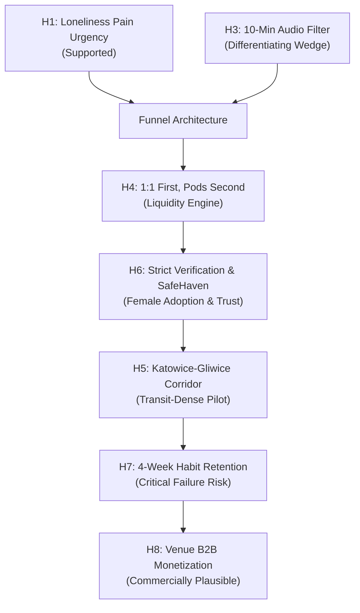
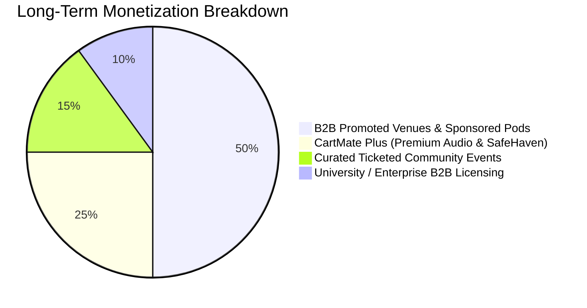
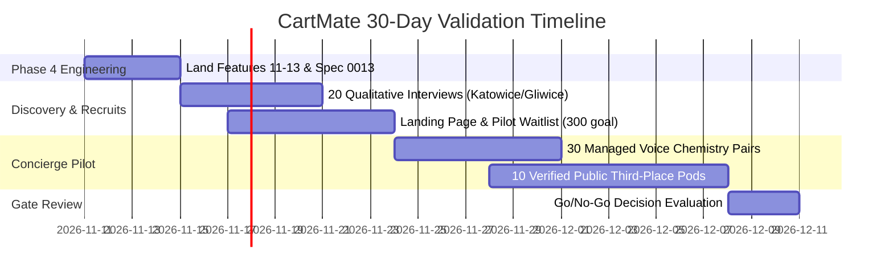

# CartMate: Comprehensive Product, Business, & Market Review
**Target Market:** Silesia Metropolitan Area (GZM — Katowice, Gliwice, Chorzów), Poland  
**Core Thesis:** Platonic adult connection through a voice-first 1:1 chemistry filter and structured 3–5 person micro-pods anchored at verified public third places.  
**Document Status:** Ratified Strategic Assessment  
**Reference Commit:** [`1062091`](file:///C:/Users/user/cartmate/docs/scope/scope.md)

---

## 1. Executive Summary & Verdict

> [!IMPORTANT]
> **Strategic Verdict:** CartMate represents a compelling, highly defensible social safety architecture, but is currently a **pilot-stage product scaffold without a validated commercial engine**. A controlled, concierge-driven 30-day pilot across the **Katowice–Gliwice corridor** is justified and recommended. A broad regional launch or paid monetization layer is premature.
>
> The central strategic pivot required is **funnel sequencing**:
> 1. **Acquisition & Wedge:** 10-minute ephemeral, anonymous audio calls (low social friction, high safety, immediate liquidity).
> 2. **Conversion & Meetup:** Mutual opt-in to verified daytime/evening public third places.
> 3. **Retention & Community:** Automatic promotion of successful pairings into recurring 3–5 person micro-pods.
>
> Open 1:1 directory browsing must remain strictly disabled to prevent predatory dating-app dynamics, harassment vectors, and positioning collapse.

---

## 2. Macro Market & Demographic Evidence (Poland & Silesia)

### 2.1 The Epidemic of Urban Loneliness
- **Polish National Context (2025–2026 Reports):**
  - **29% of Gen Z** and **25% of Millennials / Gen X** report persistent, daily feelings of isolation and loneliness ([Forsal Report](https://forsal.pl/lifestyle/zdrowie/artykuly/11261619,samotnosc-w-polsce-w-2026-jak-samotnosc-wplywa-na-prace-i-zdrowie-psychiczne-polakow-jakie-koszty-dla-firm-raport.html)).
  - **38% of Polish urban adults** express an active, unmet desire to expand their platonic friend circle.
  - **11% of young adults** report having zero emergency contacts or people they can call in immediate distress.
- **Category Economics:**
  - The global "friendship and community tech" sector reached ~$16M in US consumer spend and ~4.3M downloads in 2025 ([Loneliness Economy](https://lonelinesseconomy.com/friendship-app-market-2026-inflection)). Despite high intent, the market lacks an undisputed global winner due to poor post-match retention (the "satisfaction churn" problem) and high customer acquisition costs.

### 2.2 Silesian Metropolitan Area (Górnośląsko-Zagłębiowska Metropolia — GZM)
- **Population Density:** 2.1 million residents across contiguous urban centers.
- **Pilot Epicenter:** Katowice (279,000 pop.) and Gliwice (168,000 pop.).
- **Academic & Tech Cluster:** **92,800 active university students** across the University of Silesia, Silesian University of Technology (Politechnika Śląska), and UE Katowice. High concentration of relocators, software engineers, and young professionals.
- **Transit Mobility:** Integrated DTŚ highway spine, Tramwaje Śląskie, and Koleje Śląskie provide 15–25 minute intercity transit between Katowice, Chorzów, and Gliwice.
- **Demographic Vulnerability:** Silesia suffers from macro depopulation and suburban flight, making concentrated, public-transit-oriented meeting hubs essential for local liquidity.

---

## 3. Competitive Landscape & Positioning Matrix

| Platform | Format & Model | Geographic Scope | Price to User | Critical Strengths | Critical Weaknesses & Vulnerabilities |
| :--- | :--- | :--- | :--- | :--- | :--- |
| **PicMe** *(Direct Rival)* | Spontaneous "Meeting Zones", 5-min timed 1:1 encounters, venue beacons | 10 Polish cities (inc. Katowice at Bajsownia); 200k claimed users | 100% Free to consumer; monetizes via B2B venue fees | Already live in Silesia; strong PR momentum; free entry | No voice pre-filter; high in-person rejection risk; purely serendipity-dependent |
| **Timeleft** *(Direct Competitor)* | Algorithm-matched 4–6 person Wednesday dinners at local restaurants | 200+ cities globally; Poland: Warsaw, Kraków, Wrocław, Gdańsk (No Silesia) | 39.99 PLN / event or monthly subscription; food paid separately | High brand recognition; proven paid willingness; strong rituals | High no-show rates; safety/moderation complaints on Trustpilot; zero presence in Silesia |
| **222** *(US Benchmark)* | AI-curated small group outings & dinners | 21 US cities; $13.7M VC funding | $22 / month + event billings | Sophisticated psychographic clustering; cult brand loyalty | iOS-only; US-only; high churn if dynamic falls flat |
| **Meet5** *(European Benchmark)* | 6–12 person group activities (meals, hikes, cultural walks) | Germany, Austria, Switzerland (540k MAU) | Freemium (Premium boosts & chat) | Excellent organic retention in 40+ demographic; low barrier | Older demographic skew (40–60); zero safety vetting; no audio/voice pre-screening |
| **Meetup** *(Legacy Incumbent)* | Organizer-hosted clubs, talks, and hobby gatherings | Global (60M members, 330k groups) | Free for attendees; $20–$35/mo for organizers | Massive SEO reach; deep hobby specialization | High friction; anonymous, unmoderated crowds; low conversion to close 1:1 friendships |
| **Bumble For Friends** *(App Store Incumbent)* | 1:1 card-swiping directory with group chat features | US, Canada, UK, Australia (Not localized/marketed in Poland) | Freemium (Bumble coins, spotlights) | World-class UI; 82% female demographic adoption | High swipe-fatigue; feels like dating; extreme ghosting rates (>70%) |
| **Wakie** *(Audio Benchmark)* | Ephemeral 1-on-1 stranger voice calls across topic prompts | Global (10M+ registered users) | Freemium (Plus subscription, gifts) | Proves high demand for quick, anonymous voice conversations | Zero real-world meetup bridge; random international matching; low trust |
| **CartMate** *(Proposed)* | 10-min anonymous voice filter + structured 3–5 micro-pods at verified third places | Katowice & Gliwice pilot corridor | Free in pilot (Sponsored venue pods in Phase 2) | Combined voice + pod safety; quorum gating; strict 112/block sync; verified venues | Unproven brand; two-sided liquidity challenge; zero current monetization code |

---

## 4. Hypothesis Testing & Empirical Stress Test



### H1: Adult loneliness in Polish urban centers is an acute pain point driving behavioral action.
- **Verdict: Supported.**
- **Evidence:** Over 38% of Polish urban adults report seeking new social ties; PicMe gathered 200,000 sign-ups in Poland within 18 months, and Timeleft regularly books 450+ paid attendees per month in Warsaw alone.
- **Operational Reality:** People want friends, but fear awkwardness, rejection, and personal safety risks.

### H2: Consumers will pay an upfront software fee for friendship matchmaking.
- **Verdict: Partially Supported (High Elasticity in Poland).**
- **Evidence:** Timeleft charges 39.99 PLN per seat, and 222 charges $22/month. However, in Poland, digital consumer subscription fatigue is severe. Competing against free alternatives (PicMe, Facebook Groups, Meetup) means consumer paywalls crush top-of-funnel conversion. Monetization must follow proven habit formation, not precede it.

### H3: A 10-minute anonymous voice call provides the optimal trust/chemistry filter.
- **Verdict: Unproven at Scale, Highly Plausible as a Competitive Wedge.**
- **Evidence:** Audio reveals vocal warmth, pacing, authenticity, and language fluency within 90 seconds while preserving complete anonymity (zero phone numbers or social handles exchanged). It eliminates the catfishing and aesthetic anxiety of video or photo profiles.
- **Failure Mode:** Microphone anxiety or poor audio reliability will increase drop-off if the UI does not provide strong, structured icebreaker prompts.

### H4: 1:1 matching is easier to fill, but 3–5 person pods create superior psychological safety.
- **Verdict: Supported — Resolvable via Staged Sequencing.**
- **Evidence:** Assembling 3 to 5 people with matching schedules, venues, and activity preferences in a single neighborhood requires high active density ($\ge 500$ MAU per postal code). A 1:1 pairing requires 1/5th the liquidity. However, in-person 1:1 meetups trigger severe safety concerns (especially for women).
- **The Solution:** Use 1:1 voice calls as the digital icebreaker, then assemble pod meetups at scheduled weekly anchor times.

### H5: The Katowice–Gliwice corridor possesses sufficient density to sustain a pilot.
- **Verdict: Supported under Constrained Scope.**
- **Evidence:** 92,800 students and high DTŚ/rail commuter density. Testing region-wide (all of Silesia) will fail due to travel frictions. The pilot must restrict itself strictly to the Katowice Centrum (Mariacka / Dworcowa / Strefa Kultury) and Gliwice Rynek clusters.

### H6: Strict safety verification (ID tiering, SafeHaven, mutual block) drives female participation.
- **Verdict: Strongly Supported.**
- **Evidence:** In Polish social surveys, **90% of women demand public venue anchors**, and **78.5% demand verified identity safeguards**. Bumble BFF achieved an 82% female user base specifically due to aggressive anti-creep guardrails. CartMate's SafeHaven and instant bidirectional block sync represent the product's highest-converting feature for female users.

### H7: Users will maintain 30-day retention and attend recurring sessions.
- **Verdict: High Risk / Unproven.**
- **Evidence:** The friendship sector suffers from 30-day retention rates often below 15%. PicMe reports ~30% repeat attendance. Without a recurring ritual (e.g., "Every Thursday Study Sprint" or "Sunday Park Walk"), users churn as soon as they meet one compatible acquaintance.

### H8: CartMate can achieve commercial sustainability without display advertising.
- **Verdict: Plausible via Venue Partnerships & B2B Sponsored Hubs.**
- **Evidence:** Silesian cafes, craft breweries, board game pubs, and coworking spaces spend heavily on off-peak customer acquisition (Tuesday–Thursday evenings). Charging venues 15–25 PLN per confirmed patron seat or a monthly listing fee (199 PLN/month) aligns incentives without charging lonely users.

### H9: Technical and operational readiness is sufficient for pilot release.
- **Verdict: Conditioned on Phase 4 Audit Closure.**
- **Evidence:** Core WebRTC voice signaling, quorum-gated pod chat, and SQLite storage are verified (`223` backend tests pass). However, Phase 4 items (atomic strict voice table rebuild, production TURN startup guard, full four-language copy, and multi-user Playwright E2E suites) must land before opening public admission.

---

## 5. Core Product Strategy: 1:1 vs. Micro-Pods

### The Strategic Dilemma
- **The 1:1 Pitfall:** Open 1:1 swiping rapidly degenerates into a clandestine dating market, driving out platonic users and attracting predatory harassment.
- **The 3–5 Pod Pitfall:** Assembling a 5-person pod requires 5 simultaneous participants to agree on time, place, and topic. If one drops, quorum collapses, leading to cancellations and user frustration.

### The CartMate Tri-Bridge Architecture

```
[Phase A: Digital Discovery]
  10-Minute Ephemeral Voice Call (1:1)
  - Topic: "Study Sprint", "Board Games", "Park Walk"
  - Anonymous: First name & city only
  - Hard 10:00 timer + Spoken milestones + 12s drop grace
             │
             ▼ Mutual "Respectful" Post-Call Rating
[Phase B: Micro-Pod Formation]
  Third-Place Pod Assembly (3–5 Members)
  - Anchored at verified public venues (e.g., Katowice Library, Gliwice Rynek)
  - Zero expected spend (Free / Pay-for-yourself)
  - Quorum-gated group chat (Unlocks instantly at 3/3 confirmed attendees)
             │
             ▼ In-Person Shared Activity
[Phase C: Safe Community Retention]
  Local Cohort Membership & Recurring Meetups
  - Mutual block sync: withdrawing from shared pods silently
  - SafeHaven verification tiering
  - 1-tap 112 emergency routing
```

---

## 6. Katowice–Gliwice Pilot Operational Blueprint

### 6.1 Venue Anchor Selection (Third Places)
1. **Katowice Academic Cluster:**
   - *Biblioteka Śląska (Plac Rady Europy)* — Ideal for `study_sprint` (Quiet, safe, monitored, public).
   - *Strefa Kultury / NOSPR Concourse* — Ideal for `park_walk` & cultural outings.
   - *Kawiarnia Lokal (Katowice Centrum)* — Verified coffee/discussion anchor.
2. **Gliwice Academic & Tech Corridor:**
   - *Rynek w Gliwicach (Monitored pedestrian plaza)* — Accessible meeting point.
   - *Centrum Kultury Studenckiej MROWISKO (Pszczyńska)* — Student and young professional coworking anchor.
   - *Ludiversum / Board Game Cafes* — Pre-existing infrastructure for structured `board_games` pods.

### 6.2 Pilot Operating Cadence
- **Fixed Schedule:** Tuesdays and Thursdays at 18:00–21:00 (Evening Pods), Saturdays at 14:00 (Park Walks & Board Games).
- **Voice Window:** Strictly enforced 18:00–23:00 Warsaw time.
- **Target Scale:** 150–250 verified participants admitted via pilot codes in 3 selected university/tech hubs.

---

## 7. Monetization Strategy & Unit Economics

### 7.1 Infrastructure Cost Drivers
- **Twilio SMS OTP:** ~0.18 PLN per verification attempt (Console provider used in dev; Twilio/SMSAPI in production).
- **WebRTC TURN Relay (Coturn / Metered TURN):** ~0.015 PLN per 10-minute relayed voice call (P2P direct audio is free; TURN required on restrictive NATs/cellular).
- **Database & Compute (Render / VPS):** ~$25–$50 / month for low-latency FastAPI + SQLite + Redis WebSocket pub/sub.
- **Estimated Operating Cost Per Active User:** ~0.45 PLN / month.

### 7.2 Revenue Models


1. **B2B Venue Subscriptions (Primary — Follows PicMe Proof):**
   - Verified local venues pay a monthly subscription (149–299 PLN/month) or pay-per-pod seat (5 PLN/seated member) to be featured as default pod anchors during slow weekday shifts.
2. **CartMate Plus (Secondary Consumer Subscription — 19.99 PLN/month):**
   - Extended voice call duration (15 min instead of 10 min).
   - Increased daily call limit (6 calls instead of 3).
   - Advanced SafeHaven women-only pod filters.
   - Verified Gold ID trust badge.
3. **University & Corporate Wellness Partnerships:**
   - Sponsored integration for international exchange students (Erasmus+ in Silesia) to mitigate expat isolation.

---

## 8. Technical Readiness & Governance Status

### 8.1 Technical Integrity at Commit `1062091`
- **Backend Test Suite:** `223 / 223` tests pass in `backend/test_voice_calls.py`, `backend/test_operator_admission_pilot.py`, and related suites.
- **Ops & DR Drills:** `15 / 15` tests pass in `ops/test_disaster_recovery.py` and `ops/test_pilot_preflight.py`.
- **Static Analysis & Build:** Frontend passes `oxlint` with 0 warnings; Vite build bundles clean lazy chunks (`PodFeed: 24.71 kB`, `VoiceCallHUD: 26.13 kB`).
- **Security & Origin Probes:** `qa/codex_mr02_destination_probe.cjs` confirms zero bearer token leakage across all 10 Pod and Voice client API helpers on unapproved native origins.

### 8.2 Blocking Phase 4 Audit Closure Tasks (Governed by [`Spec 0013`](file:///C:/Users/user/cartmate/docs/specs/0013-final-audit-closure.md))
1. **Feature 11 (`GA`):** Atomic Python migration runner [`m0013_voice_calls_strict_rebuild.py`](file:///C:/Users/user/cartmate/backend/migrations/m0011_micro_pods.py) to safely rebuild existing non-STRICT `v12` voice tables without data loss, plus lifespan-scoped hard startup refusal on missing/default `CARTMATE_TURN_SECRET` in production.
2. **Feature 12 (`Beta`):** Full 4-language localization (`PL`, `EN`, `UK`, `RU`) eliminating all remaining hardcoded Polish text in `PodFeed.tsx`, `VoiceCallHUD.tsx`, and `SafetyHub.tsx`.
3. **Feature 13 (`GA`):** Dedicated multi-user Playwright suite ([`qa/tests/pods-and-voice.spec.ts`](file:///C:/Users/user/cartmate/qa/tests/)) verifying two-user live quorum unlock, real-time drawer chat delivery, and WebRTC fake-media voice calls with rating submissions, plus root-level `pytest` environment isolation.

---

## 9. 30-Day Lean Validation Plan & Gateways



### Quantitative Go / No-Go Gateways

| Metric / Objective | Minimum Acceptable Threshold | Strong Commercial Signal | Failure / Pivot Indicator |
| :--- | :--- | :--- | :--- |
| **Voice Call Completion Rate** | $\ge 40\%$ of admitted users complete $\ge 1$ call | $\ge 65\%$ completion rate | $< 25\%$ (Severe microphone friction) |
| **Post-Call Meetup Conversion** | $\ge 35\%$ mutual opt-in after call | $\ge 50\%$ mutual opt-in | $< 20\%$ (Audio fails to build trust) |
| **In-Person Pod Show Rate** | $\ge 60\%$ of confirmed members show up | $\ge 80\%$ attendance rate | $< 40\%$ (High no-show flake rate) |
| **30-Day Repeat Activity** | $\ge 25\%$ join a second call or pod within 30 days | $\ge 40\%$ monthly repeat | $< 15\%$ (Ghosting / novelty churn) |
| **Safety & Moderation Incidents**| **Zero** unhandled safety/harassment complaints | 100% resolution within 2 hrs | $\ge 1$ serious unhandled incident |
| **Venue Willingness to Pay** | $\ge 2$ venues agree to a 150 PLN/mo trial | $\ge 4$ venue partnership LOIs | 0 venues willing to host |

---

## 10. Research Bibliography & Verified Data Sources

1. **Timeleft Platform & Safety Operations:**  
   - [Timeleft How It Works](https://timeleft.com/how-it-works/)  
   - [Timeleft Locations: Poland](https://timeleft.com/locations/poland/)  
   - [Timeleft Trustpilot Safety & Harassment Complaints](https://www.trustpilot.com/review/timeleft.com)
2. **PicMe Polish Social Market Entry:**  
   - [PicMe Official Platform](https://picme.pl)  
   - [MamStartup: PicMe Social-Tech Launch Analysis](https://mamstartup.pl/maja-dosc-swipeow-i-matchowania-chca-czegos-realnego-tworcy-picme-odwracaja-mechanizm-tindera-i-buduja-nowa-kategorie-social-tech/)  
   - [Zawsze Pomorze: Samotność w tłumie i nowe aplikacje](https://zawszepomorze.pl/artykul/28380,samotnosc-w-tlumie-czy-aplikacja-nauczy-nas-na-nowo-rozmawiac)
3. **Macro Demographics & Polish Loneliness Statistics:**  
   - [Forsal: Samotność w Polsce 2025/2026](https://forsal.pl/lifestyle/zdrowie/artykuly/11261619,samotnosc-w-polsce-w-2026-jak-samotnosc-wplywa-na-prace-i-zdrowie-psychiczne-polakow-jakie-koszty-dla-firm-raport.html)  
   - [Metropolia GZM Info-Map & Urban Demographics](https://infogzm.metropoliagzm.pl/en/info-map/)
4. **Global Friendship App Industry Economics:**  
   - [Loneliness Economy: Friendship App Market Inflection](https://lonelinesseconomy.com/friendship-app-market-2026-inflection)  
   - [TechCrunch: Andy Dunn’s Pie Social Architecture](https://techcrunch.com/2026/08/25/andy-dunns-startup-pie-becomes-less-of-an-events-app-and-more-of-a-social-network/)  
   - [Bumble BFF Country & Demographic Availability](https://support.bumblebff.com/hc/en-us/articles/37693593412637-Availability-of-BFF)  
   - [The Inference: 222 Social Curation & Economics](https://theinference.org/article/222-s-app-store-says-this-is-not-a-dating-app-its-storefront-sells-blind-dates-on-a-22-subscription)  
   - [Meet5 Demographie & European Operations](https://business.meet5.com/de/demographie)
